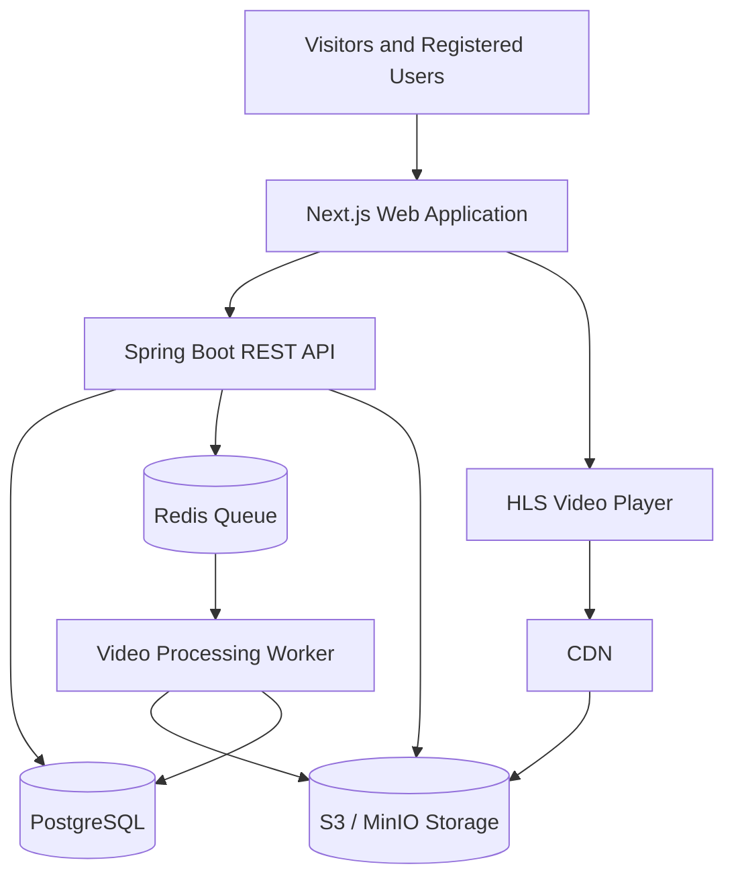
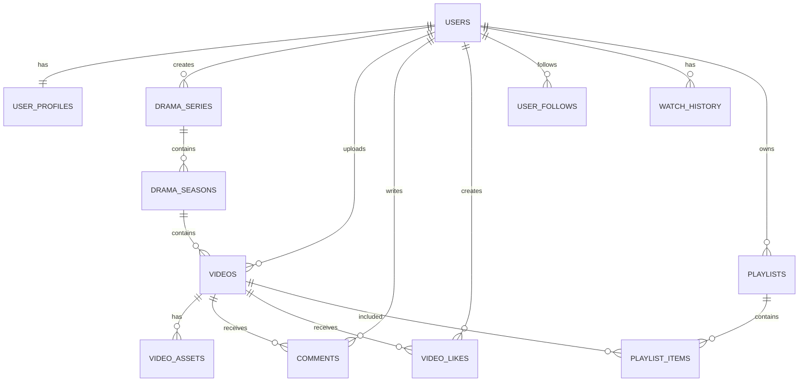

# AI Drama – Product Requirements & Software Specification

**Project Name:** AI Drama  
**Document Type:** Product Requirements Document (PRD) + Software Requirements Specification (SRS)  
**Version:** 1.1  
**Status:** Initial Product Specification  
**Target Platform:** Web Application (Responsive Desktop, Tablet, Mobile)  
**Frontend:** Next.js, TypeScript, shadcn/ui  
**Backend Recommendation:** Spring Boot REST API  
**Database:** PostgreSQL  
**Audience:** Individual creators, AI filmmakers, and public viewers  
**Product Model:** Community-driven public video streaming platform

---

# 0. Glossary and Document Conventions

## 0.1 Glossary

| Term | Definition |
|---|---|
| Series | A top-level episodic production that contains one or more seasons. |
| Season | A numbered grouping of episodes within a series. |
| Episode | A video that belongs to a season within a series. |
| Movie | A standalone, full-length video with no series or season parent. |
| Short | A short-form standalone video. |
| Visibility | Who may access a content item: public, unlisted, or private. |
| Publication Status | The lifecycle state of a content item (draft, processing, ready, published, unpublished, failed, removed). |
| HLS | HTTP Live Streaming; the adaptive streaming format delivered to the player. |
| Transcoding | Converting an uploaded source video into multiple streaming renditions. |
| Rendition | A single resolution/bitrate variant produced during transcoding. |
| Asset | A stored media file (source, rendition, manifest, segment, thumbnail, poster, or subtitle). |
| Creator | A registered user who uploads and publishes content. |
| View | A counted playback event that satisfies the platform view-counting policy. |

## 0.2 Requirement Keywords

The keywords **must**, **should**, and **may** are used as follows:

- **Must:** A mandatory requirement for the release it is assigned to.
- **Should:** A strong recommendation that may be deferred only with explicit justification.
- **May:** An optional capability.

## 0.3 Identifier and Slug Conventions

- All primary keys should be non-sequential, non-guessable identifiers (for example, UUID or ULID) to avoid exposing counts or enabling enumeration.
- Slugs are human-readable, URL-safe, lowercase, and unique within their routing namespace.
- Timestamps are stored in UTC and returned in ISO 8601 format.

---

# 1. Project Overview

## 1.1 Vision

AI Drama is a community-driven streaming platform where users can upload, publish, discover, manage, and watch AI-generated entertainment content.

The platform allows anyone to become an AI drama creator and share their productions with a public audience.

Users can upload complete AI-generated movies, episodic dramas, short films, and other video content. Other registered users and visitors can discover and watch publicly published content.

The platform combines three primary experiences:

1. **Content Creation:** Users upload and manage their AI-generated productions.
2. **Video Streaming:** Viewers watch movies, dramas, episodes, and short videos.
3. **Social Community:** Users interact with creators and other viewers through follows, comments, likes, and sharing.

## 1.2 Core Concept

Think of a combination of:

- YouTube – public video publishing and creator channels.
- Netflix – structured movie, series, and episode viewing.
- TikTok – short-form video discovery and vertical viewing.
- Community platforms – creator profiles, followers, comments, and interactions.

However, the platform is specifically focused on AI-generated entertainment.

The objective is to build a dedicated destination for AI-generated movies and dramas rather than a general-purpose video-sharing website.

## 1.3 Product Objectives

- Allow users to upload AI-generated video content.
- Allow creators to publish public dramas and movies.
- Allow other users to watch publicly shared content.
- Support episodic dramas with seasons and episodes.
- Support standalone movies and short videos.
- Provide a personalized content discovery experience.
- Allow creators to manage their published and unpublished productions.
- Encourage community interaction and content sharing.
- Provide administrators with content moderation and platform management capabilities.
- Establish an architecture that can support future monetization and increased traffic.

## 1.4 Target Users

| User Type | Description |
|---|---|
| Guest Viewer | Browses and watches public content without an account, subject to platform policies. |
| Registered Viewer | Watches, likes, comments, follows creators, and manages a personal watchlist. |
| Creator | Uploads, publishes, and manages AI-generated content. |
| Content Moderator | Reviews reports and handles inappropriate content. |
| Administrator | Manages users, content, platform settings, and operations. |

A registered user can simultaneously be a viewer and a creator. There is no need for separate accounts.

---

# 2. Product Scope

## 2.1 Content Types

The platform must support multiple entertainment formats.

### A. AI Drama Series

A series contains multiple seasons and episodes.

Example:

- Series: The Last Kingdom of AI
- Season 1
  - Episode 1 – The Beginning
  - Episode 2 – The Betrayal
  - Episode 3 – The Last Battle
- Season 2
  - Episode 1 – The Return

### B. AI Movies

Standalone full-length AI-generated movies.

Example:
- Title: Beyond the Universe
- Duration: 1 hour and 25 minutes
- Genre: Science Fiction
- Format: Full-length movie

### C. AI Shorts

Short-form AI-generated videos.

Example:
- 30-second cinematic scene
- 2-minute AI action sequence
- 5-minute short drama
- AI-generated comedy

### D. Other Future Formats

The system should be extensible to support:
- Trailers
- Teasers
- Behind-the-scenes videos
- Mini-series
- Anthology collections

## 2.2 Content Visibility

Creators should have control over content visibility.

| Visibility | Behavior |
|---|---|
| Public | Anyone can discover and watch. |
| Unlisted | Anyone with the sharing link can watch, but it is excluded from public discovery. |
| Private | Only the creator and explicitly authorized users can access it. |

**Default publishing behavior:** Public.

Publicly published AI dramas should be available for other users to discover and watch.

The creator should be able to change visibility or unpublish content at any time, subject to platform moderation and legal retention policies.

## 2.3 Out of Scope for Initial Release

The following are future enhancements, not MVP requirements:

- Live streaming.
- AI video generation directly inside the platform.
- Built-in video editing.
- Creator revenue sharing.
- Subscription-based premium content.
- Paid advertisements.
- Native Android and iOS applications.
- Real-time collaborative video production.

The platform initially focuses on uploading, publishing, managing, discovering, and watching AI-generated entertainment.

---

# 3. Functional Requirements

# Module 1: User Authentication and Account Management

## 3.1 Registration

Users can register using:
- Email address
- Password
- Display name
- Username

Requirements:
- Email verification.
- Unique username.
- Secure password storage.
- Login and logout.
- Forgot password.
- Password reset.
- Account deactivation.
- Account deletion request.

Future enhancement:
- Google authentication.
- Social login.
- Multi-factor authentication.

## 3.2 User Profile

Each registered user has a public profile.

Profile information:
- Profile picture.
- Display name.
- Username.
- Bio.
- Join date.
- Published content.
- Follower count.
- Following count.
- Total views.
- Social links (optional).

Users can:
- Edit their profile.
- Change their profile picture.
- Update their biography.
- View their own published content.
- View their followers and following lists.

Private account information must never be exposed through public profile endpoints.

---

# Module 2: Creator Studio

The Creator Studio is the main content management area for creators.

It should provide a dashboard where creators can manage all their AI-generated productions.

## 3.3 Creator Dashboard

Dashboard widgets:

- Total views.
- Total published content.
- Total drafts.
- Total followers.
- Recently uploaded content.
- Most viewed content.
- Recent comments.
- Upload processing status.

Example dashboard layout:

**Overview**
- 12 Published Videos
- 4 Drafts
- 25,000 Total Views
- 850 Followers

**Recent Content**
- The Last Kingdom – Episode 1
- Beyond the Universe
- The Final Mission

## 3.4 Content Management

Creators can:

- Upload new content.
- Create a new drama series.
- Create standalone movies.
- Create short videos.
- Edit video information.
- Replace a video file.
- Upload a thumbnail.
- Save content as a draft.
- Publish content.
- Unpublish content.
- Change visibility.
- Delete content.
- Organize content into seasons and episodes.

Content management must support search, sorting, pagination, and filtering.

Filters:
- All content.
- Published.
- Draft.
- Processing.
- Failed.
- Unpublished.

## 3.5 Video Metadata

Every video should support the following information:

| Field | Description |
|---|---|
| Title | Video or episode title |
| Description | Content summary |
| Thumbnail | Video cover image |
| Content Type | Movie, episode, short, trailer |
| Genre | Action, romance, fantasy, horror, etc. |
| Language | Original spoken language |
| Subtitles | Available subtitle tracks |
| Release Date | Publication date |
| Duration | Automatically detected |
| Visibility | Public, unlisted, private |
| AI Generated | AI-generated content declaration |
| Content Rating | Appropriate audience classification |
| Tags | Search and discovery keywords |

Optional metadata:
- Cast/characters.
- Director or creator credits.
- Production notes.
- AI tools used.
- Original soundtrack credits.
- Content warnings.

## 3.6 Series Management

Creators should be able to organize episodic productions.

Hierarchy:

Series → Seasons → Episodes

Requirements:

1. Create a series.
2. Upload a series poster.
3. Add a series description.
4. Create seasons.
5. Add episodes to seasons.
6. Set episode numbers.
7. Reorder episodes.
8. Edit episode information.
9. Publish or unpublish individual episodes.
10. Manage the publication status of the overall series.

Important business rule:

An episode cannot be publicly discoverable as an independent published episode if its parent series is private or unpublished. Explicitly shared episode links must still respect parent visibility and access permissions.

## 3.7 Upload Management

The upload experience should be simple but capable of handling large video files.

Supported initial formats:
- MP4
- MOV
- WebM

Requirements:
- Drag-and-drop upload.
- File selection.
- Upload progress.
- Upload cancellation.
- Retry failed uploads.
- Large file support through multipart uploads.
- Automatic video metadata extraction.
- Thumbnail upload or generation.
- Video processing status.
- Upload history.

Video processing statuses:

`PENDING → UPLOADING → PROCESSING → READY`

Failure state:

`FAILED`

The user must be able to see why an upload or processing operation failed.

---

# Module 3: Video Processing and Streaming

## 3.8 Video Processing

Uploaded videos should not be served directly as the primary streaming format.

The platform should process videos into streaming-compatible versions.

Recommended processing workflow:

1. Creator uploads a video.
2. Video is stored in temporary or original media storage.
3. Backend creates a processing job.
4. Worker validates the video.
5. Worker extracts duration and metadata.
6. Worker generates thumbnails.
7. Worker transcodes the video.
8. Worker creates HLS streaming output.
9. Processed assets are stored in permanent media storage.
10. Content status becomes READY.
11. Creator can publish the content.

Recommended technology:
- FFmpeg for transcoding.
- Redis for job queue management.
- Background worker for video processing.
- S3-compatible object storage for media.
- HLS for adaptive streaming.

## 3.9 Adaptive Video Streaming

The video player should support adaptive playback.

Suggested resolutions:
- 360p
- 480p
- 720p
- 1080p

Higher resolutions such as 1440p and 4K can be introduced when infrastructure and demand justify the additional processing and storage costs.

The player should:
- Automatically select a suitable quality.
- Allow manual quality selection.
- Support fullscreen.
- Support playback speed.
- Support subtitles.
- Support volume controls.
- Support keyboard shortcuts.
- Support picture-in-picture where available.
- Support mobile and desktop playback.
- Resume from the last watched position.

## 3.10 Watch Experience

A dedicated watch page should display:

- Video player.
- Title.
- Description.
- Creator information.
- View count.
- Publication date.
- Like button.
- Share button.
- Add to watchlist.
- Comments.
- Related content.
- Next episode, when applicable.
- Previous episode, when applicable.

For series:

The player should provide:
- Season selector.
- Episode selector.
- Next episode.
- Previous episode.
- Continue watching.
- Episode list.

When an episode finishes, the platform should recommend the next episode and optionally provide an autoplay countdown.

Autoplay should be configurable by the viewer.

## 3.11 Watch History

Registered users should have a watch history.

Information recorded:
- User.
- Video.
- Last playback position.
- Total watched duration.
- Last watched timestamp.
- Completion status.

Requirements:
- Resume watching.
- Remove individual history items.
- Clear watch history.
- Continue watching section.
- Mark completed videos.

Guest users may watch public content without persistent cross-session history.

---

# Module 4: Public Discovery and Streaming Experience

## 3.12 Home Page

The public homepage is the primary discovery area.

Recommended sections:

1. Featured AI Dramas.
2. Trending This Week.
3. Recently Published.
4. Popular AI Movies.
5. AI Drama Series.
6. AI Shorts.
7. Most Watched.
8. Recommended for You.
9. Continue Watching (authenticated users only).
10. New Creators.

The homepage should prioritize content discovery rather than account registration.

## 3.13 Explore Page

Users can browse all publicly published content.

Filtering:
- Movies.
- Drama Series.
- Episodes.
- Shorts.
- Genre.
- Language.
- Publication date.
- Popularity.
- Duration.

Sorting:
- Most popular.
- Most viewed.
- Recently published.
- Most liked.
- Trending.

## 3.14 Search

Global search should support:

- Drama titles.
- Movie titles.
- Episode titles.
- Creator usernames.
- Genres.
- Tags.
- Descriptions.

Search should provide:
- Search suggestions.
- Recent searches.
- Search history.
- Filtered results.
- Pagination.

Future enhancement: Full-text search using OpenSearch if PostgreSQL search becomes insufficient.

## 3.15 Genre Management

Initial genre list:

- Action
- Adventure
- Animation
- Comedy
- Crime
- Documentary
- Drama
- Fantasy
- Horror
- Mystery
- Romance
- Science Fiction
- Thriller
- Historical
- Family

Administrators should be able to manage the genre list.

---

# Module 5: Community and Social Interaction

## 3.16 Likes

Registered users can like publicly accessible content.

Requirements:
- Like and unlike.
- Display like count.
- Prevent duplicate likes.
- Update counts efficiently.

## 3.17 Comments

Viewers can comment on content.

Requirements:
- Add comments.
- Edit own comments.
- Delete own comments.
- Reply to comments.
- Like comments.
- Report comments.
- Creator can moderate comments on their own content.
- Administrators can remove inappropriate comments.

Comment moderation should support disabling comments for individual content items.

## 3.18 Follow Creators

Users can follow other creators.

Requirements:
- Follow.
- Unfollow.
- View followers.
- View following.
- View followed creators' latest publications.
- Optional notification when a creator publishes new content.

## 3.19 Sharing

Every public drama, movie, and short should have a shareable URL.

Example:

`https://aidrama.example.com/watch/the-last-kingdom-episode-1`

Sharing features:
- Copy link.
- Share through available device sharing options.
- Social sharing metadata.
- Open Graph thumbnail.
- Public viewing without requiring an account.

The sharing link must respect content visibility, deletion, and moderation status.

## 3.20 Watchlist and Collections

Users can save videos to their watchlist.

Additional collection features:
- Create personal collections.
- Add and remove videos.
- Rename collections.
- Set collection visibility.
- Share public collections.

Example:
- My Favorite AI Dramas
- Sci-Fi Movies
- Watch Later

---

# Module 6: Notifications

## 3.21 In-App Notifications

Notifications should include:

- New follower.
- New comment.
- Comment reply.
- Content liked.
- Followed creator published a new drama.
- Video processing completed.
- Video processing failed.
- Content moderation notice.

Users should be able to:
- View notifications.
- Mark as read.
- Mark all as read.
- Configure notification preferences.

Email notifications can be added later.

---

# Module 7: Analytics

## 3.22 Creator Analytics

Creators should have access to basic content performance information.

Metrics:
- Total views.
- Unique viewers (where reliably measurable).
- Likes.
- Comments.
- Average watch duration.
- Completion rate.
- Views per video.
- Views per episode.
- Follower growth.

Analytics should be aggregated rather than calculated from the entire raw playback event history on every dashboard request.

## 3.23 View Counting Rules

A video view should not simply be counted every time the player loads.

The platform should implement a reasonable view-counting policy to reduce:
- Repeated refresh abuse.
- Automated traffic.
- Bot-generated views.
- Artificial view inflation.

The exact view-counting threshold should be configurable and documented.

---

# Module 8: Administration and Moderation

## 3.24 Admin Dashboard

Administrators should have a separate administrative interface.

Dashboard:
- Total users.
- Total creators.
- Total published content.
- Total video views.
- Total storage consumption.
- Pending moderation reports.
- Failed processing jobs.
- Recent platform activity.

## 3.25 User Management

Administrators can:
- View users.
- Search users.
- Suspend accounts.
- Reactivate accounts.
- Review reported accounts.
- Review creator activity.
- Manage user roles.

## 3.26 Content Moderation

Since this is a public upload platform, moderation is mandatory.

Administrators should be able to:
- Review uploaded content.
- Remove prohibited content.
- Unpublish content.
- Suspend offending users.
- Review user reports.
- Record moderation reasons.
- Review content appeals.

Content reporting categories:
- Copyright infringement.
- Inappropriate content.
- Violence or graphic content.
- Sexual or exploitative content.
- Harassment.
- Spam.
- Misleading content.
- Other.

The platform should establish clear content policies, age ratings, AI-content labeling, and copyright complaint procedures.

AI-generated content must not be assumed to be free of copyright, trademark, likeness, or other legal restrictions.

## 3.27 Copyright and Content Ownership

Creators must confirm that they have the rights or permissions needed to upload and distribute their content.

The platform should provide:
- Copyright policy.
- Content ownership declaration.
- Copyright complaint submission.
- Takedown workflow.
- Repeat-infringer policy.
- Appeals process.

The platform should not claim ownership of uploaded creator content.

The creator grants the platform a limited license to host, process, stream, and display the content according to the Terms of Service.

---

# 4. User Interface and Navigation

## 4.1 Public Navigation

Recommended desktop navigation:

- Home
- Explore
- Movies
- Series
- Shorts
- Search
- Login / Sign Up

Authenticated navigation:

- Home
- Explore
- Movies
- Series
- Shorts
- My Library
- Notifications
- Creator Studio
- Profile

## 4.2 Creator Studio Navigation

- Overview
- My Content
- Series Manager
- Upload Content
- Analytics
- Comments
- Settings

## 4.3 Admin Navigation

- Dashboard
- Users
- Content
- Reports
- Moderation
- Genres
- Processing Jobs
- System Settings
- Audit Logs

## 4.4 UI Design Principles

The design should feel like a modern streaming application.

Design requirements:
- Dark theme as the default viewing experience.
- Minimal and clean interface.
- Large video thumbnails.
- Clear content categories.
- Responsive layouts.
- Consistent spacing and typography.
- shadcn/ui components.
- Accessible controls.
- Skeleton loading states.
- Empty states.
- Error states.
- Mobile-friendly navigation.

Avoid an overly colorful dashboard. Prioritize content artwork and video thumbnails.

---

# 5. Technical Architecture

## 5.1 Recommended Architecture

The application should separate the user-facing application, business APIs, video processing, and media storage.

### Frontend

**Next.js + TypeScript**

Responsibilities:
- Public website.
- Homepage and discovery.
- Video watch pages.
- Authentication UI.
- User profiles.
- Creator Studio.
- Admin dashboard.
- Responsive video player integration.

Recommended libraries:
- Next.js App Router.
- TypeScript.
- shadcn/ui.
- Tailwind CSS.
- TanStack Query.
- React Hook Form.
- Zod.
- HLS.js or a compatible HLS player.

### Backend

**Spring Boot REST API**

Responsibilities:
- Authentication and authorization.
- User and profile management.
- Content management.
- Series and episode management.
- Upload authorization.
- Publishing workflows.
- Social interactions.
- Watch history.
- Analytics.
- Notifications.
- Moderation.
- Administrative operations.

### Database

**PostgreSQL**

Stores:
- Users.
- Profiles.
- Videos.
- Series.
- Seasons.
- Episodes.
- Categories.
- Comments.
- Likes.
- Followers.
- Watch history.
- Playlists.
- Notifications.
- Reports.
- Analytics aggregates.

### Object Storage

S3-compatible storage.

Stores:
- Original video uploads.
- Transcoded video files.
- HLS manifests.
- Video segments.
- Thumbnails.
- Posters.
- Profile images.
- Subtitle files.

Possible implementations:
- MinIO for self-hosted environments.
- Cloudflare R2.
- Amazon S3.

### Background Processing

Recommended:
- Redis.
- Job queue.
- Dedicated FFmpeg worker.

Responsibilities:
- Video validation.
- Transcoding.
- Thumbnail generation.
- HLS generation.
- Metadata extraction.
- Cleanup of abandoned uploads.

### CDN

A CDN should deliver video segments and images to viewers.

It should be introduced before the platform experiences significant public traffic.

## 5.2 High-Level Architecture Diagram



## 5.3 Upload Architecture

Video uploads should use direct-to-object-storage uploads instead of passing large video files through the Next.js server or ordinary REST API request bodies.

Workflow:

1. User selects a video.
2. Next.js requests an upload session from Spring Boot.
3. Backend validates permissions and creates an upload record.
4. Backend returns signed upload URLs.
5. Browser uploads the video directly to object storage.
6. Browser confirms completion.
7. Backend verifies the uploaded object.
8. Backend creates a processing job.
9. Worker processes the video.
10. Worker updates the video status to READY.
11. Creator publishes the video.

This approach reduces API server load and supports larger uploads.

## 5.4 Streaming Architecture

The player should request an HLS master playlist.

Example structure:

```text
videos/
  video-id/
    original/
      source.mp4
    hls/
      master.m3u8
      360p/
        playlist.m3u8
        segment files
      720p/
        playlist.m3u8
        segment files
      1080p/
        playlist.m3u8
        segment files
    thumbnails/
      poster.jpg
      thumbnail-001.jpg
    subtitles/
      en.vtt
      fil.vtt
```

Public content can be delivered through a CDN. Private content should use signed playback URLs or another access-controlled delivery mechanism.

---

# 6. Database Design

The following represents the initial logical database model. Exact field types, indexes, constraints, and normalization should be finalized during technical design.

## 6.1 Core Tables

| Table | Purpose |
|---|---|
| users | Authentication and account information |
| user_profiles | Public profile information |
| user_roles | User role assignments |
| drama_series | Drama series information |
| drama_seasons | Seasons belonging to series |
| videos | Movies, episodes, shorts, trailers |
| video_assets | Original and processed media files |
| video_subtitles | Subtitle tracks |
| genres | Available content genres |
| video_genres | Video-to-genre mapping |
| video_tags | Searchable tags |
| video_likes | User likes |
| comments | Video comments |
| comment_likes | Comment likes |
| user_follows | Creator following relationships |
| watch_history | Playback progress and history |
| playlists | User collections |
| playlist_items | Videos in collections |
| notifications | User notifications |
| content_reports | Community reports |
| moderation_actions | Moderation history |
| upload_sessions | Upload tracking |
| processing_jobs | Video processing jobs |
| video_view_events | View and playback events |
| creator_analytics_daily | Aggregated creator analytics |

## 6.2 Important Relationships



## 6.3 Video Entity

Recommended fields:

```text
id
creator_id
series_id
season_id
video_type
title
slug
description
thumbnail_asset_id
duration_seconds
language
visibility
publication_status
content_rating
is_ai_generated
allow_comments
published_at
created_at
updated_at
deleted_at
```

Recommended video types:

```text
MOVIE
EPISODE
SHORT
TRAILER
TEASER
```

Recommended publication statuses:

```text
DRAFT
PROCESSING
READY
PUBLISHED
UNPUBLISHED
FAILED
REMOVED
```

Visibility and publication status must remain separate.

For example, a video can be READY but still be a DRAFT, or PUBLISHED but UNLISTED.

## 6.4 Series Entity

```text
id
creator_id
title
slug
description
poster_asset_id
language
visibility
publication_status
created_at
updated_at
```

## 6.5 Season Entity

```text
id
series_id
season_number
title
description
created_at
updated_at
```

## 6.6 Important Database Rules

- Usernames must be unique.
- Content slugs must be unique within the relevant routing namespace.
- One user cannot like the same video multiple times.
- One user cannot follow the same creator multiple times.
- Episode numbers must be unique within a season.
- Video assets must have a defined asset type and processing status.
- Deleting a series must not accidentally orphan its episodes.
- User-generated content must support moderation and soft deletion.
- Watch history should have a unique user/video relationship for the current progress record.
- Database indexes should support public content discovery and creator dashboards.

---

# 7. API Specification

The backend should expose versioned REST endpoints.

Base URL:

`/api/v1`

## 7.1 Authentication

```http
POST /auth/register
POST /auth/login
POST /auth/logout
POST /auth/refresh
POST /auth/forgot-password
POST /auth/reset-password
GET  /auth/me
```

## 7.2 Public Discovery

```http
GET /home
GET /videos
GET /videos/{id}
GET /videos/{slug}
GET /videos/trending
GET /videos/recent
GET /videos/popular
GET /videos/recommended
GET /series
GET /series/{slug}
GET /genres
GET /search?q={query}
```

## 7.3 Creator Management

```http
GET    /creator/dashboard
GET    /creator/videos
POST   /creator/videos
PUT    /creator/videos/{id}
DELETE /creator/videos/{id}
POST   /creator/videos/{id}/publish
POST   /creator/videos/{id}/unpublish
GET    /creator/analytics
```

## 7.4 Series Management

```http
POST   /creator/series
GET    /creator/series
GET    /creator/series/{id}
PUT    /creator/series/{id}
DELETE /creator/series/{id}

POST   /creator/series/{id}/seasons
PUT    /creator/seasons/{seasonId}
DELETE /creator/seasons/{seasonId}

POST   /creator/seasons/{seasonId}/episodes
PUT    /creator/episodes/{episodeId}
DELETE /creator/episodes/{episodeId}
```

## 7.5 Upload Management

```http
POST /uploads/initiate
POST /uploads/{id}/complete
GET  /uploads/{id}
POST /uploads/{id}/cancel
POST /uploads/{id}/retry
GET  /videos/{id}/processing-status
```

## 7.6 Social Features

```http
POST   /videos/{id}/like
DELETE /videos/{id}/like

GET    /videos/{id}/comments
POST   /videos/{id}/comments
PUT    /comments/{id}
DELETE /comments/{id}

POST   /users/{id}/follow
DELETE /users/{id}/follow

GET    /users/{username}/followers
GET    /users/{username}/following
```

## 7.7 Watch History

```http
GET    /users/me/history
POST   /users/me/history
DELETE /users/me/history/{videoId}
DELETE /users/me/history
GET    /users/me/continue-watching
```

## 7.8 Administration

```http
GET  /admin/dashboard
GET  /admin/users
POST /admin/users/{id}/suspend
POST /admin/users/{id}/activate

GET  /admin/reports
GET  /admin/moderation
POST /admin/content/{id}/remove
POST /admin/content/{id}/restore
```

All APIs must enforce authorization and ownership rules on the server side. Hiding frontend controls is not sufficient security.

## 7.9 Notifications

```http
GET    /users/me/notifications
POST   /users/me/notifications/{id}/read
POST   /users/me/notifications/read-all
GET    /users/me/notification-preferences
PUT    /users/me/notification-preferences
```

## 7.10 Watchlist and Collections

```http
GET    /users/me/watchlist
POST   /users/me/watchlist/{videoId}
DELETE /users/me/watchlist/{videoId}

GET    /users/me/collections
POST   /users/me/collections
PUT    /users/me/collections/{id}
DELETE /users/me/collections/{id}
POST   /users/me/collections/{id}/items
DELETE /users/me/collections/{id}/items/{videoId}
```

## 7.11 Content Reporting

```http
POST /videos/{id}/report
POST /comments/{id}/report
```

## 7.12 Request and Response Conventions

- **Versioning:** All endpoints are served under `/api/v1`. Breaking changes require a new version prefix.
- **Content type:** Requests and responses use `application/json`, except direct media uploads to object storage.
- **Authentication:** Protected endpoints require a bearer access token. Expired access tokens are refreshed through `POST /auth/refresh`.
- **Pagination:** List endpoints are paginated and accept `page` and `pageSize` (or cursor-based `cursor`) parameters, returning a consistent envelope:

```json
{
  "data": [],
  "pagination": {
    "page": 1,
    "pageSize": 20,
    "totalItems": 135,
    "totalPages": 7,
    "hasNext": true
  }
}
```

- **Sorting and filtering:** List endpoints accept documented `sort` and filter query parameters. Unsupported parameters are ignored rather than causing an error.
- **Idempotency:** Upload completion and other non-idempotent POST operations should accept an `Idempotency-Key` header so retries do not create duplicate records.
- **Correlation:** Every request and response carries a correlation identifier (for example, `X-Request-ID`) that appears in logs.

## 7.13 Error Response Format

All error responses use a consistent structure and appropriate HTTP status codes.

```json
{
  "error": {
    "code": "VALIDATION_ERROR",
    "message": "Title is required.",
    "requestId": "b3f1c2a0-...",
    "details": [
      { "field": "title", "issue": "must not be blank" }
    ]
  }
}
```

Standard status-code usage:

| Status | Meaning |
|---|---|
| 400 | Invalid request or validation failure |
| 401 | Missing or invalid authentication |
| 403 | Authenticated but not authorized (for example, not the content owner) |
| 404 | Resource not found, or hidden to avoid leaking existence |
| 409 | Conflict (for example, duplicate username, duplicate like) |
| 413 | Upload exceeds size limits |
| 422 | Semantically invalid request (for example, publishing a video that is still processing) |
| 429 | Rate limit exceeded |
| 500 | Unexpected server error |

Error responses must never leak stack traces, internal paths, or raw database errors to clients.

---

# 8. Security Requirements

The platform is public-facing, so security must be included from the beginning.

Requirements:

1. Secure password hashing.
2. Authentication and role-based authorization.
3. Creator ownership validation.
4. Signed upload URLs.
5. Upload size restrictions.
6. File type and actual media validation.
7. Malware scanning where appropriate.
8. Rate limiting.
9. Protection against SQL injection.
10. Protection against XSS.
11. CSRF protection where applicable.
12. Secure cookie configuration.
13. API request validation.
14. Access-controlled private media.
15. Audit logs for administrative actions.
16. Protection against unauthorized video access.
17. Abuse prevention for likes, views, and comments.

Recommended roles:

```text
USER
CREATOR
MODERATOR
ADMIN
SUPER_ADMIN
```

A user may have both USER and CREATOR capabilities. Creator access should be treated as an account capability rather than requiring a separate account.

---

# 9. Non-Functional Requirements

## 9.1 Performance

- Homepage should prioritize fast initial rendering.
- Use optimized images and thumbnails.
- Use pagination or infinite loading for video listings.
- Use CDN delivery for streaming.
- Avoid loading original video files for normal playback.
- Use asynchronous processing for uploads.
- Cache frequently accessed public metadata.

## 9.2 Scalability

The architecture must allow independent scaling of:

- Next.js application instances.
- Spring Boot API instances.
- Video processing workers.
- Database resources.
- Redis.
- Object storage.
- CDN delivery.

Video processing must not block ordinary API requests.

## 9.3 Availability

The system should handle:
- Temporary storage failures.
- Worker failures.
- Interrupted uploads.
- Failed transcoding.
- Expired upload sessions.
- Database connection issues.

Jobs should be retryable and idempotent.

## 9.4 Accessibility

- Keyboard-accessible navigation.
- Accessible player controls.
- Screen-reader-friendly buttons.
- Captions and subtitles.
- Appropriate contrast.
- Responsive layouts.

## 9.5 SEO

Publicly published content should be indexable.

Requirements:
- Server-rendered public pages.
- Unique page titles and descriptions.
- Open Graph metadata.
- Video thumbnails.
- Structured metadata where appropriate.
- Sitemap generation.
- Canonical URLs.

Private and unlisted content should not be indexed in public search engines.

## 9.6 Data Privacy and Retention

The platform handles personal data and user-generated content, so privacy must be designed in rather than added later.

Requirements:

- **Minimization:** Collect only the personal data needed to operate the platform.
- **Account deletion:** An account deletion request must remove or irreversibly anonymize personal data within a defined period, except data the platform is legally required to retain (for example, records tied to copyright complaints or abuse investigations).
- **Content deletion:** Deleting content soft-deletes it first, then purges associated media assets from object storage after a defined grace period.
- **Watch history and analytics:** Raw playback event data should have a defined retention window and be aggregated into summary tables; raw events older than the window can be purged.
- **Consent and preferences:** Notification and, where applicable, cookie or tracking preferences must be user-configurable and honored.
- **Data export:** Where required by applicable regulation, users should be able to request an export of their personal data.
- **PII handling:** Personally identifiable information must not appear in logs, URLs, analytics identifiers, or error messages.

## 9.7 Observability and Logging

The platform should be operable and debuggable in production.

Requirements:

- **Structured logging:** Logs are structured (for example, JSON) and include the correlation identifier, user or request context, and severity, without leaking secrets or PII.
- **Metrics:** Export application and infrastructure metrics — API latency and error rates, queue depth, worker throughput, transcoding duration, upload success rate, and playback startup time.
- **Tracing:** Support distributed tracing across the frontend, API, and worker where feasible.
- **Health checks:** Each service exposes liveness and readiness endpoints for orchestration.
- **Alerting:** Define alerts for elevated error rates, processing-job backlog, storage saturation, and failed health checks.
- **Audit trail:** Administrative and moderation actions are recorded in an immutable audit log (see section 8).

---

# 10. Business Rules

1. Any registered user can become a creator.
2. Creators can upload multiple videos.
3. A video must finish processing before it can be published.
4. Public videos are available to everyone.
5. Unlisted videos are accessible through their direct links.
6. Private videos are accessible only to authorized users.
7. Only the content owner or authorized administrator can edit content.
8. Users must authenticate before liking, commenting, following, or saving content.
9. Users cannot interact with content that has been removed or blocked.
10. Creators can disable comments.
11. A series may contain multiple seasons.
12. A season may contain multiple episodes.
13. Episodes inherit access restrictions from their parent series.
14. A creator cannot publish content that is still processing or has failed processing.
15. Administrators can override publication visibility for moderation purposes.
16. Content creators retain ownership of their uploaded content, subject to the platform's Terms of Service.
17. AI-generated content must be clearly identified.
18. Users must follow platform content, safety, and copyright policies.

---

# 10A. Thin-Slice Delivery Strategy (Walking Skeleton)

This section refines the roadmap in section 11. The roadmap lists features in logical order; this section defines the **order of risk** — the shortest path that proves the hardest part works before the rest is built.

## 10A.1 Why a Thin Slice First

The highest technical risk is the media path, not the social or admin features. The single end-to-end line that must work is:

**Sign up → Upload a video → Process to HLS → Watch it**

Everything else (likes, comments, follows, admin, search) is low-risk CRUD that is straightforward once this line works. Building those first would mean building on an unproven core.

The goal of the walking skeleton is one real video, uploaded by one real account, processed into HLS, and played back in the browser — nothing more.

## 10A.2 Frontend-First Decision

For the current stage, work begins with the **frontend only**. The backend is defined in sections 5–8 but is not yet built. The frontend is built against a typed API client with mock data so that:

- UI, routing, and the design system can progress independently of the backend.
- The API contract in section 7 is exercised early through TypeScript types.
- Screens are demonstrable before any server or video pipeline exists.

When the backend is ready, the mock data layer is swapped for real HTTP calls behind the same typed client, with no UI changes required.

## 10A.3 Frontend Walking-Skeleton Scope

Mandatory screens for the frontend thin slice:

| Screen | Purpose |
|---|---|
| Home | Public discovery grid of published videos (mock data). |
| Watch | Video player page with title, description, creator, metadata. |
| Auth | Sign up and log in forms (UI + validation only). |
| Creator Studio — Overview | Dashboard shell with stat widgets. |
| Creator Studio — Upload | Upload form UI with drag-and-drop and progress states. |
| Creator Studio — My Content | List of the creator's videos with status badges. |

Deferred from the frontend thin slice: series/season management UI, comments, likes, follows, watchlist, notifications, admin, search. These follow once the skeleton is demonstrable.

## 10A.4 Frontend Technical Baseline

| Concern | Decision for the thin slice |
|---|---|
| Framework | Next.js App Router + TypeScript. |
| UI | shadcn/ui + Tailwind CSS, dark theme default. |
| Forms | React Hook Form + Zod. |
| Server state | TanStack Query. |
| Data source | Mock API layer behind a typed client; real HTTP swapped in later. |
| Player | HLS.js, fed a sample public HLS stream until the real pipeline exists. |
| Auth | UI and client-side validation only; no real token flow until the backend exists. |

## 10A.5 Exit Criteria for the Frontend Thin Slice

The frontend skeleton is done when:

1. The app runs locally with `npm run dev`.
2. Home, Watch, Auth, and the three Creator Studio screens render with mock data.
3. The watch page plays a sample HLS stream in the browser.
4. The upload form shows the full `PENDING → UPLOADING → PROCESSING → READY` status UI against mock state.
5. The build passes `npm run build` and `npm run lint` with no errors.

---

# 11. Development Roadmap

Development should be divided into manageable phases.

## Phase 1 – Foundation and Authentication

- Initialize Next.js project.
- Initialize Spring Boot project.
- Configure PostgreSQL.
- Configure authentication.
- Implement user registration and login.
- Implement user profiles.
- Implement application layout.
- Configure role-based authorization.

**Deliverable:** Users can register, log in, and manage their accounts.

## Phase 2 – Content Management

- Implement Creator Studio.
- Implement video metadata.
- Implement movie creation.
- Implement series management.
- Implement seasons and episodes.
- Implement draft and publishing workflows.
- Implement content visibility.

**Deliverable:** Creators can create and manage AI drama content.

## Phase 3 – Upload and Video Processing

- Integrate object storage.
- Implement multipart uploads.
- Implement upload progress.
- Integrate Redis.
- Implement video processing worker.
- Integrate FFmpeg.
- Generate thumbnails.
- Generate HLS output.
- Implement processing status tracking.

**Deliverable:** Creators can upload videos and prepare them for streaming.

## Phase 4 – Public Streaming

- Build public homepage.
- Build explore page.
- Build movie listings.
- Build drama series pages.
- Build episode pages.
- Integrate HLS player.
- Implement watch page.
- Implement next episode.
- Implement watch history.

**Deliverable:** Anyone can discover and watch published AI dramas.

## Phase 5 – Community Features

- Likes.
- Comments.
- Replies.
- Follow creators.
- Watchlists.
- Sharing.
- Notifications.
- User profiles and creator channels.

**Deliverable:** The platform becomes a community rather than just a video repository.

## Phase 6 – Administration and Moderation

- Admin dashboard.
- User management.
- Content reports.
- Moderation workflows.
- Copyright complaints.
- Audit logs.
- Platform settings.

**Deliverable:** Administrators can operate and moderate the platform.

## Phase 7 – Analytics and Optimization

- Creator analytics.
- View tracking.
- Trending algorithms.
- Search optimization.
- CDN integration.
- Caching.
- Performance testing.
- Security testing.

**Deliverable:** A production-ready platform with operational visibility.

---

# 12. MVP Definition

The first release should focus on the complete creator-to-viewer workflow.

The following are mandatory MVP features.

| Feature | Priority |
|---|---|
| User registration and login | Must Have |
| User profile | Must Have |
| Upload AI-generated video | Must Have |
| Video processing | Must Have |
| Create movies | Must Have |
| Create drama series | Must Have |
| Create seasons and episodes | Must Have |
| Creator Studio | Must Have |
| Draft and publish | Must Have |
| Public content discovery | Must Have |
| Public video streaming | Must Have |
| Video sharing | Must Have |
| Search | Must Have |
| Basic genre filtering | Must Have |
| Watch history | Must Have |
| Like videos | Should Have |
| Comments | Should Have |
| Follow creators | Should Have |
| Watchlist | Should Have |
| Admin moderation | Must Have |
| Creator analytics | Later |
| Notifications | Later |
| Monetization | Future |

## MVP Acceptance Criteria

The MVP is considered functional when the following end-to-end workflow succeeds:

1. A user registers an account.
2. The user creates or accesses their Creator Studio.
3. The creator uploads an AI-generated movie.
4. The video uploads successfully to storage.
5. The processing worker converts it into a streaming format.
6. The creator enters the video title, description, genre, and thumbnail.
7. The creator publishes the video publicly.
8. Another user opens the homepage.
9. The published video appears in public discovery.
10. The second user opens the video page.
11. The video plays successfully.
12. The second user can share the video link.
13. Another visitor opens the shared link and watches the video.
14. The creator can see the video in their content management dashboard.

The same workflow must also work for an episodic series.

---

# 12A. Quality and Testing Strategy

Quality gates should be defined alongside functionality rather than after it.

## Test Levels

- **Unit tests:** Business logic, validation, and authorization rules on the backend; utilities and components on the frontend.
- **Integration tests:** API endpoints against a real database and object storage (for example, using containers), covering ownership and visibility enforcement.
- **End-to-end tests:** The critical creator-to-viewer workflow defined in the MVP acceptance criteria, including the episodic series path.
- **Contract tests:** Keep the frontend and backend aligned on request and response shapes.

## Priority Test Scenarios

- Visibility and publication rules: a draft, private, or still-processing video is never publicly discoverable or playable.
- Episode inheritance: an episode is not discoverable when its parent series is private or unpublished.
- Ownership: a user cannot edit, unpublish, or delete content they do not own.
- Upload lifecycle: resumable uploads, cancellation, retry, and expired upload sessions.
- Processing lifecycle: `PENDING → UPLOADING → PROCESSING → READY`, plus the `FAILED` path with a visible reason.
- Abuse prevention: duplicate likes, duplicate follows, and view-count inflation are rejected.
- Access control on media: private content requires signed or access-controlled playback URLs.

## Non-Functional Testing

- Load and soak testing of discovery endpoints and playback startup.
- Processing throughput testing under concurrent uploads.
- Security testing covering the items in section 8 (authorization, injection, XSS, CSRF, rate limiting, media validation).
- Accessibility testing against the requirements in section 9.4.

## Definition of Done

A feature is complete when it is implemented, covered by appropriate automated tests, passes security and accessibility checks relevant to it, is observable through logs and metrics, and its API matches the documented contract.

---

# 13. Future Business Opportunities

The architecture should leave room for additional capabilities.

## 13.1 Creator Monetization

Potential future revenue models:
- Advertising revenue sharing.
- Premium subscriptions.
- Paid exclusive dramas.
- Creator memberships.
- Donations and tipping.
- Sponsored content.

## 13.2 Premium Streaming

Allow creators to designate selected content as premium.

Possible access models:
- Free.
- Subscriber-only.
- One-time purchase.
- Creator membership.

This requires payment integration and a more advanced entitlement system.

## 13.3 AI-Powered Discovery

Future recommendation features:
- Personalized recommendations.
- Similar drama recommendations.
- Genre-based suggestions.
- Personalized home feed.
- Recommendations based on viewing history.

## 13.4 Creator Tools

Future creator-focused enhancements:
- AI-generated descriptions.
- Automatic subtitle generation.
- Automatic language detection.
- Video chapter generation.
- Trailer management.
- Content scheduling.
- Bulk episode uploads.
- Creator performance insights.

These features should assist creators but should not be prerequisites for publishing content.

## 13.5 Community Expansion

- Public collections.
- Community discussions.
- Creator collaboration.
- Featured creators.
- Community events.
- User reviews.
- Curated drama collections.

---

# 14. Recommended Initial Technology Stack

| Layer | Technology |
|---|---|
| Frontend | Next.js App Router |
| Language | TypeScript |
| UI | shadcn/ui + Tailwind CSS |
| Forms | React Hook Form + Zod |
| Server State | TanStack Query |
| Backend | Spring Boot |
| API | REST |
| Authentication | Keycloak or Spring Security |
| Database | PostgreSQL |
| ORM | Spring Data JPA |
| Cache / Queue | Redis |
| Video Processing | FFmpeg |
| Video Format | HLS |
| Media Storage | MinIO / S3 |
| Video Delivery | CDN |
| Deployment | Docker |
| Reverse Proxy | Caddy |
| Monitoring | Prometheus + Grafana (future) |

---

# 15. Recommended Initial Deployment Architecture

For the first deployment, avoid unnecessary microservices.

Use a modular monolith for the business backend, with a separate video processing worker.

Suggested services:

```text
ai-drama/
├── frontend
│   └── Next.js
│
├── backend
│   └── Spring Boot
│
├── video-worker
│   └── FFmpeg processing
│
├── database
│   └── PostgreSQL
│
├── cache
│   └── Redis
│
├── storage
│   └── MinIO
│
└── reverse-proxy
    └── Caddy
```

This keeps the application maintainable and easier to deploy.

The video processing worker can scale independently when upload volume increases.

---

# 16. Product Success Metrics

The platform should measure:

**Creator adoption**
- Number of registered creators.
- Number of active creators.
- Number of videos uploaded.
- Number of published series.

**Viewer engagement**
- Daily active viewers.
- Total video views.
- Average watch duration.
- Episode completion rate.
- Watchlist additions.

**Community**
- Number of followers.
- Comments per video.
- Likes per video.
- Shared content links.

**Platform health**
- Upload success rate.
- Video processing success rate.
- Streaming startup time.
- Playback failure rate.
- Storage utilization.
- API response time.

---

# 17. Final Product Direction

AI Drama should be developed as a **public AI entertainment community with creator-owned content libraries and a streaming-first viewing experience**.

The main user journey is:

**Create → Upload → Process → Publish → Discover → Watch → Interact → Share**

The most important product decision is to make content publishing and watching work exceptionally well before adding advanced AI features or monetization.

The platform should not become an AI video-generation tool. It should become the place where people publish, discover, and watch AI-generated entertainment.

**Initial release objective:** A user can upload an AI-generated drama, organize it into a series with episodes, publish it publicly, and allow anyone else to watch and share it.

---

# 18. Open Questions and Assumptions

These decisions are intentionally deferred to technical design but must be resolved before the related feature ships.

## 18.1 Open Questions

| # | Topic | Question |
|---|---|---|
| 1 | View counting | What are the exact thresholds (minimum watch time, dedupe window, per-user/IP rules) that qualify a playback as a counted view? |
| 2 | Upload limits | What are the maximum file size, maximum duration, and allowed codecs for an initial upload? |
| 3 | Retention | How long are raw playback events, soft-deleted content, and deleted-account data retained before purge? |
| 4 | Rate limits | What are the per-endpoint and per-user rate limits for auth, uploads, and social actions? |
| 5 | Content rating | Which rating scheme is used, and is it self-declared, automated, or moderated? |
| 6 | Authentication | Keycloak or Spring Security for the initial release, and is session- or token-based auth preferred? |
| 7 | Moderation timing | Is content moderated pre-publish, post-publish, or report-driven at launch? |
| 8 | Guest access | Which content and features, if any, are available to guests versus requiring registration? |
| 9 | Transcoding targets | Which renditions and bitrate ladder are produced at launch given cost constraints? |

## 18.2 Working Assumptions

- A single account can act as both viewer and creator; no separate creator account is required.
- Default visibility on publish is public.
- The initial deployment is a modular monolith plus an independent video-processing worker.
- Full-text search starts on PostgreSQL and migrates to OpenSearch only if needed.
- Media is stored in S3-compatible storage and delivered through a CDN before significant public traffic.

---

**End of Specification – Version 1.1**